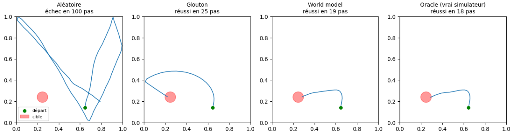
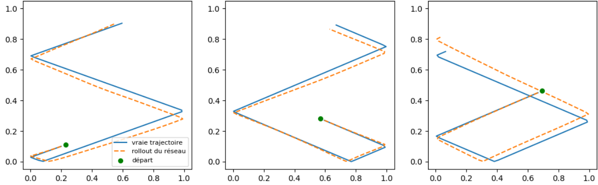

# World Models : de la prédiction à la planification dans un espace latent



Implémentation progressive d'un world model au sens de LeCun (2022), sur une tâche contrôlée :
une balle qui rebondit dans une boîte 2D. Le projet construit l'architecture brique par brique,
en validant chaque étape avant d'ajouter la suivante.

```
s(t) = Enc(x(t))              →  perception
ŝ(t+1) = Pred(s(t), a(t))     →  modèle du monde
a* = argmin_a  coût(ŝ)        →  planification
```

## Motivation

Un agent qui apprend uniquement par essais et erreurs a besoin d'énormément d'interactions avec son
environnement : c'est lent, coûteux, parfois dangereux. Un humain sait qu'une chute d'une falaise
serait fatale sans avoir besoin d'essayer. Un world model permet d'apprendre la dynamique d'un
environnement, puis de planifier « en imagination » avant d'agir.

## Structure

| Notebook | Contenu | Encodeur | Action | Planification |
|---|---|---|---|---|
| `WM_step1.ipynb` | Prédire la dynamique à partir des positions | Fixé à la main | ✗ | ✗ |
| `WM_step2.ipynb` | Ajouter les actions, planifier vers une cible | Fixé à la main | ✓ | ✓ |
| `WM_step3.ipynb` | Apprendre la représentation à partir d'images (JEPA) | Appris | ✓ | ✓ |

## En résumé

- Un prédicteur de dynamique 24× plus précis que l'extrapolation linéaire au voisinage des rebonds.
- Une planification MPC à parité avec un oracle disposant de la dynamique exacte (100 % de réussite).
- Un encodeur JEPA qui retrouve position et vitesse à partir des seules images, sans jamais
  recevoir de coordonnées.
- La divergence des rollouts latents diagnostiquée et corrigée par une loss multi-pas
  (erreur à 20 pas divisée par ≈ 50).
- Une limite de la planification en espace latent mise en évidence et analysée : la métrique
  latente sature hors d'un voisinage de la cible.

---

## Étape 1 : Prédire la dynamique

Un MLP prédit le déplacement de la balle à partir de ses 3 dernières positions. Les rebonds sont la
seule non-linéarité du problème. La baseline est l'extrapolation linéaire (« la balle refait son
dernier déplacement »), exacte loin des murs.



**Protocole** : 500 trajectoires, séparation *par trajectoire* (80/10/10), prédiction du déplacement
Δp plutôt que de la position, évaluation séparée loin des murs et autour des rebonds.

**Résultats** (erreur moyenne à un pas, sur le test) :

| Situation | Réseau | Extrapolation linéaire |
|---|---|---|
| Loin des rebonds | 2,0e-04 | 3,1e-18 *(exacte)* |
| Autour des rebonds | 6,7e-04 | 1,6e-02 |

Le réseau est 24 fois plus précis que la baseline autour des rebonds. En rollout, ses trajectoires
imaginées suivent la vraie trajectoire sur plus de 100 pas en traversant plusieurs rebonds
(erreur de 0,11 à 100 pas, contre 3,09 pour la baseline, qui ignore les murs).

---

## Étape 2 : Agir et planifier

La balle reçoit à chaque pas une poussée qui modifie sa vitesse. Le modèle apprend l'effet des actions,
puis un agent l'utilise pour amener la balle vers une cible : il imagine 500 suites de 10 actions,
retient la meilleure, exécute sa première action, et replanifie au pas suivant
(*random shooting*, schéma MPC).

**Résultats du modèle** (erreur moyenne à un pas, sur le test) :

| Situation | Part | Réseau | Baseline (déplacement + action) |
|---|---|---|---|
| Mouvement libre | 81,5 % | 2,0e-04 | 4,1e-17 *(exacte)* |
| Vitesse saturée | 6,1 % | 1,4e-03 | 2,0e-03 |
| Autour des rebonds | 12,5 % | **3,3e-03** | 2,1e-02 |

**Résultats de la planification** (50 épisodes, cible atteinte si la balle passe à moins de 0,05) :

| Agent | Réussite | Pas moyens |
|---|---|---|
| Aléatoire | 36 % | 52,9 |
| Glouton (pousse vers la cible) | 54 % | 26,2 |
| **World model** | **100 %** | **17,1** |
| Oracle (vraie physique) | 100 % | 18,0 |

Le world model planifie aussi bien que la vraie physique. L'agent glouton échoue une fois sur
deux : la balle a de l'élan et dépasse la cible, ce qui montre la nécessité d'anticiper. Les rollouts
du modèle divergent à long terme, mais la replanification à chaque pas depuis la position réelle
empêche les erreurs de s'accumuler.

---

## Étape 3 : JEPA : apprendre la représentation à partir d'images

L'agent ne reçoit plus de coordonnées, mais des **images** 32×32. Un encodeur convolutif apprend
seul une représentation latente (dimension 32), et le prédicteur travaille entièrement dans cet
espace. L'entraînement combine une énergie de prédiction latente et la régularisation
**VICReg** (variance + covariance) contre le collapse.

### Le latent contient l'état physique de la balle

Pas de collapse : l'écart-type des latents reste stable autour de 1,07, et le rang effectif de leur
covariance atteint **32,0 / 32**, aucune direction du latent n'est inutilisée.

Le contenu du latent est mesuré par des sondes entraînées *après coup* sur un encodeur figé
(les vraies coordonnées ne sont jamais vues par la JEPA) :

| Sonde | R² position (x, y) | R² vitesse (vx, vy) | Erreur de position |
|---|---|---|---|
| Linéaire — encodeur aléatoire | 0,41 / 0,50 | 0,00 / 0,00 | 0,260 |
| Linéaire — encodeur JEPA | 0,95 / 0,99 | 0,06 / 0,01 | 0,063 |
| **MLP — encodeur JEPA** | **1,00 / 1,00** | **0,91 / 0,90** | **0,014** |

L'encodeur retrouve la position à moins d'un demi-pixel et la vitesse avec un R² de 0,91, à partir
des seules images. La position est linéairement accessible, la vitesse ne l'est pas : rien
n'impose à l'encodeur de lui réserver une direction du latent, puisque le prédicteur, non linéaire,
peut l'en extraire. Une sonde linéaire qui échoue mesure donc l'accessibilité d'une information,
pas sa présence.

### Divergence des rollouts latents, et correction

Entraîné à prédire **un seul pas**, le prédicteur ne voit en entrée que des latents produits par
l'encodeur à partir de vraies images. En rollout, on lui réinjecte ses propres prédictions, déjà
décalées : il sort de son domaine d'entraînement et l'erreur croît exponentiellement.

La correction consiste à enchaîner K = 5 prédictions pendant l'entraînement, chacune comparée au
vrai latent du même instant, le latent réinjecté étant celui imaginé :

```
L_pred = (1/K) Σ_{k=1..K} ‖ ŝ(t+k) − Enc(x(t+k−1), x(t+k)) ‖²
         avec  ŝ(t+k) = Pred(ŝ(t+k−1), a(t+k−1))
```

Le prédicteur reçoit donc ses propres latents dérivés et apprend à les ramener vers la trajectoire
correcte. La correction n'est pas ajoutée à la main : elle est apprise.

**Erreur de position des rollouts** (lue par la sonde MLP ; plancher de la sonde : 0,0135) :

| Horizon | Entraînement 1 pas | Entraînement multi-pas (K = 5) |
|---|---|---|
| 1 pas | 0,0157 | **0,0137** |
| 5 pas | 0,0847 | **0,0220** |
| 20 pas | 4,17 | **0,0793** |

À 20 pas, l'erreur est **≈ 50 fois plus faible**, et sa croissance devient linéaire. La stabilité se
prolonge au-delà de l'horizon d'entraînement : la courbe ne présente aucune rupture à K = 5, donc
le prédicteur n'a pas mémorisé des séquences de cinq pas mais appris une dynamique latente stable.

### Planification depuis une image de la cible : une limite de la métrique latente

L'agent reçoit le but sous forme d'**image** (une balle à l'endroit de la cible), l'encode en
`s_goal`, et planifie entièrement dans le latent : le coût d'une suite d'actions est la distance
moyenne entre les latents imaginés et `s_goal`. Aucune coordonnée n'intervient ni dans
l'observation, ni dans le coût, ni dans le choix de l'action.

| Agent | Réussite | Pas moyens (si réussite) |
|---|---|---|
| Aléatoire | 28 % | 48,9 |
| **JEPA (images seules)** | **38 %** | 13,4 |
| Oracle (vraie physique) | 100 % | 17,0 |

L'agent JEPA échoue dans la majorité des épisodes, alors que le même planificateur atteint 100 % avec
la vraie physique. Deux indices orientent le diagnostic : quand il réussit il est plus rapide que
l'oracle (13,4 pas), donc il ne réussit que les cibles déjà proches ; et sur les trajectoires, il
part dans la bonne direction puis s'immobilise à mi-chemin, signature d'un minimum local du coût.

**Diagnostic**: Pour que le coût guide l'agent, la distance latente à `s_goal` doit croître avec la
distance réelle à la cible. Mesurée sur 2 000 observations de test, la corrélation n'est que de
**0,34 à 0,37** : la distance latente croît tant que la balle est à moins de ~0,25 de la cible, puis
sature. Au-delà, le coût est plat, aucune direction n'est préférable, et l'agent s'arrête.

Hypothèse testée et écartée. L'image objectif étant constituée de deux images identiques, elle
représente une balle immobile, situation jamais rencontrée à l'entraînement, donc potentiellement
hors distribution. Remplacer cette image fabriquée par une vraie observation du dataset où la balle
passe au plus près de la cible ne change rien (0,34 contre 0,37).

**Conclusion.** Le problème n'est pas le contenu du latent, que les sondes valident, ni le prédicteur,
fiable sur 20 pas : c'est la géométrie de l'espace latent. Rien dans l'objectif JEPA n'impose que
les distances latentes reflètent les distances réelles, la loss demande seulement que le latent soit
prédictible, varié et décorrélé. Un bon modèle du monde ne suffit donc pas : encore faut-il que
l'espace où l'on planifie soit muni d'une métrique exploitable.

---

## Choix méthodologiques

- **Séparation par trajectoire** (jamais par pas), pour que les trajectoires de test soient réellement
  inédites.
- **Baselines systématiques** : extrapolation linéaire, agent glouton, oracle disposant de la vraie
  physique, encodeur aléatoire. Un résultat isolé ne se juge pas.
- **Prédiction des variations** (Δp, Δs) plutôt que des états : sur de petits déplacements, prédire
  l'état permet d'obtenir une loss faible en recopiant simplement l'entrée.
- **Statistiques VICReg sur batchs mélangés** : calculées par batch, les termes de variance et de
  covariance sont biaisés si un batch contient des transitions consécutives d'une même trajectoire.
  Ce point, découvert en cours de route, expliquait un écart de loss trompeur en validation.
- **Sondes comme instruments de mesure**, jamais comme composants du modèle : entraînées après coup
  sur un encodeur figé, et toujours accompagnées du « plancher » qu'elles introduisent dans toute
  erreur mesurée.

## Pistes

- Apprendre une métrique latente exploitable pour la planification (objectif contrastif ou
  quasimétrique appris), au lieu de la distance euclidienne.
- Sous-buts intermédiaires, pour rester dans le voisinage où le coût reste informatif.
- Distracteurs visuels et dynamique stochastique, pour comparer la JEPA à un modèle qui reconstruit
  les pixels.

## Lancer le projet

```bash
pip install torch numpy matplotlib scikit-learn
```

Les notebooks 1 et 2 s'exécutent sur CPU en quelques minutes. Le notebook 3 nécessite un GPU pour
l'entraînement (testé sur Colab et Kaggle T4) ; l'évaluation et la planification tournent sur CPU.

## Références

- LeCun, *A Path Towards Autonomous Machine Intelligence*, 2022
- Bardes, Ponce, LeCun, *VICReg: Variance-Invariance-Covariance Regularization*, ICLR 2022
- Assran et al., *Self-Supervised Learning from Images with a JEPA (I-JEPA)*, CVPR 2023
- Ha, Schmidhuber, *World Models*, 2018
